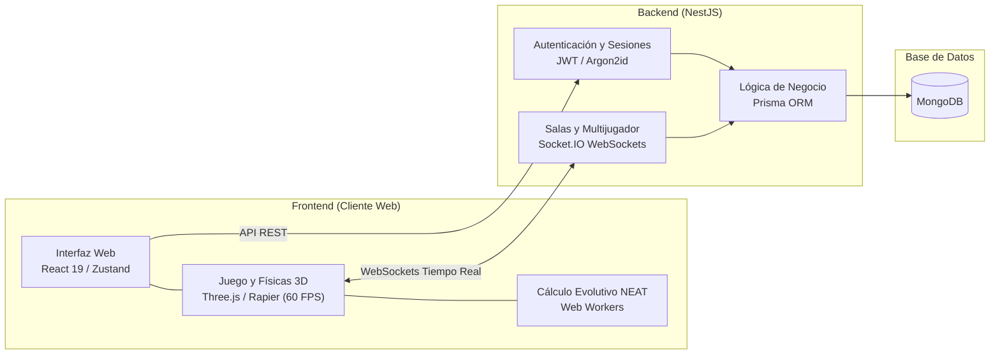

<div align="center">

  

  # Synapse Racing

  **Plataforma web de carreras 3D con conducción autónoma (NEAT) y multijugador en tiempo real**

  <br/>

  [](https://github.com/synapse-racing)
  [](https://github.com/synapse-racing)
  [](https://github.com/synapse-racing)

  <br/>

  <p>
    
    
    
    
    
    
    
    
    
  </p>

</div>

---

## Sobre el Proyecto

**Synapse Racing** es un proyecto desarrollado en el marco académico universitario para la materia de desarrollo de aplicaciones web. Como equipo decidimos plantear el trabajo práctico alrededor del desarrollo de un **videojuego de carreras en 3D** directamente ejecutable desde el navegador web, integrando simulación física, entrenamiento de agentes autónomos con algoritmos evolutivos y juego multijugador en red.

El juego propone dos modalidades principales:

1. **Modo Entrenamiento (Inteligencia Artificial):** Los autos aprenden a completar el circuito de forma autónoma mediante el algoritmo **NEAT** (*NeuroEvolution of Augmenting Topologies*). La simulación corre en el navegador y permite ver la evolución de las redes neuronales a través de las distintas generaciones.
2. **Modo Multijugador:** Creación de salas privadas para competir en tiempo real contra otros jugadores con sincronización vía WebSockets.

---

## ¿Cómo Funciona la IA en el Juego?

Los vehículos autónomos no siguen una línea predefinida en el circuito, sino que toman decisiones en base a sensores virtuales:

```
                  [ -30° Raycast ]    [ 0° Raycast ]    [ +30° Raycast ]
                          \                  |                  /
       [ -60° Raycast ] ---\                 |                 /--- [ +60° Raycast ]
                             \               |               /
                            ┌────────────────────────────────┐
                            │        Auto Autónomo           │
                            └────────────────┬───────────────┘
                                             │
                                             ▼
                            ┌────────────────────────────────┐
                            │     Red Neuronal (NEAT)        │
                            │ Topología y pesos evolutivos   │
                            └────────────────┬───────────────┘
                                             │
                            ┌────────────────┴───────────────┐
                            ▼                                ▼
                    Dirección [-1, 1]              Acelerador / Freno [-1, 1]
```

- **Entradas:** 5 sensores de distancia por raycast ($-60^\circ, -30^\circ, 0^\circ, +30^\circ, +60^\circ$) y la velocidad longitudinal del vehículo.
- **Salidas:** Dos valores continuos que controlan el ángulo de giro y la aceleración o frenado.
- **Cálculo de Rendimiento (Fitness):** Cada generación evalúa a los autos sumando puntos por distancia recorrida y checkpoints completados, premiando la velocidad media y penalizando choques contra muros o quedarse inmóvil.

---

## Arquitectura de la Aplicación

La solución está construida desacoplando el cliente web interactivo del servidor de juego y persistencia:


