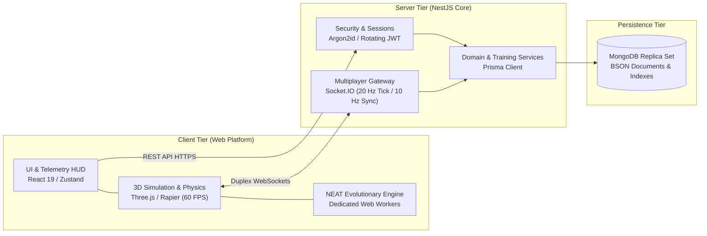

<div align="center">

  

  # Synapse Racing

  **3D Autonomous Neural Driving, Evolutionary Simulation & Real-Time Multiplayer Web Platform**  
  *An academic software engineering project bridging neuroevolutionary AI, rigid-body physics, and authoritative network gaming.*

  <br/>

  [](https://github.com/synapse-racing)
  [](https://github.com/synapse-racing)
  [](https://github.com/synapse-racing)

  <br/>

  <p>
    
    
    
    
    
    
    
    
    
  </p>

</div>

---

## Overview

**Synapse Racing** is a high-performance web platform designed to explore continuous autonomous vehicle control through evolutionary computing and real-time multiplayer synchronization. Developed as a university capstone project for advanced web application engineering, the system combines real-time 3D rigid-body dynamics, client-side neural evolution with **NEAT** (*NeuroEvolution of Augmenting Topologies*), and an authoritative backend running on **NestJS** and **MongoDB**.

The platform is designed around two core game modes:

1. **Autonomous Training (NEAT AI):** Simulates a population of 24 autonomous agents in the browser learning to navigate complex technical race tracks. Evolutionary calculations run in background Web Workers, featuring real-time raycast visualization, multi-speed controls, and deterministic state restoration.
2. **Authoritative Multiplayer Racing:** Private lobbies supporting up to 64 concurrent players. The server executes physics at 20 Hz, broadcasts state snapshots at 10 Hz via WebSockets, and clients smoothly interpolate remote vehicles using position and quaternion slerp algorithms.

---

## Core Capabilities

### 1. Neuroevolution & Autonomous Driving (NEAT)
- **Topological Neural Evolution:** Dynamically evolves both connection weights and network architecture (adding nodes and synaptic connections) across generations without backpropagation.
- **Genetic Speciation & Elitism:** Employs genomic distance thresholds and historical innovation markings to protect topological innovations in sub-species before global competition.
- **Sensor Telemetry & 3D Visualizer:** Real-time distance measurement using 5 raycast sensors ($-60^\circ, -30^\circ, 0^\circ, +30^\circ, +60^\circ$) rendered directly in the 3D scene.
- **Deterministic Replay & Persistence:** Generational checkpoints, population snapshots, PRNG states, and best-performing genomes persist atomically in MongoDB via Prisma.
- **Simulation Speed Control:** Configurable simulation multipliers (1x, 2x, 4x, etc.) enabling rapid generational iteration without UI frame drops.

### 2. High-Fidelity 3D Physics & Circuit Design
- **Deterministic Rigid-Body Physics:** Vehicle kinematics, wheel friction, tire grip, and collision detection driven by **Rapier Physics** (`@react-three/rapier`) running at a fixed 60 Hz timestep.
- **Procedural & Technical Circuits:** Multiple track topologies (`curved-loop-v1`, `technical-loop-v2`, `grand-prix-v3`) featuring scalable scenery, elevation bounds, banked corners, intermediate checkpoints, and lap-crossing detection.
- **Decoupled Architecture:** High-frequency rendering and physics lifecycles operate outside React component reconciliation to ensure persistent 60 FPS performance.

### 3. Server-Authoritative Real-Time Multiplayer
- **Tick-Based Server Simulation:** NestJS hosts an in-memory game loop ticking at 20 Hz to validate inputs, compute vehicle positions, and eliminate client-side cheating.
- **Bandwidth-Optimized Snapshots:** Broadcasts serialized race snapshots at 10 Hz via Socket.IO WebSockets.
- **Client Interpolation:** The frontend buffers recent snapshots and interpolates positions and rotations (quaternion slerp) for jitter-free multi-car rendering.
- **Scalable Lobbies:** Private rooms support configurable capacities from 2 up to 64 simultaneous racers, complete with ready states, track selection, and host race controls.

### 4. Enterprise Security & Architecture
- **In-Memory JWT Access Tokens:** Short-lived Bearer tokens for authenticated API interactions.
- **Rotating HttpOnly Refresh Tokens:** Session tokens stored in secure `HttpOnly` cookies, with cryptographic hashes verified via **Argon2id** against MongoDB. Supports concurrent multi-device logins.
- **Clean Modular Design:** Follows domain-driven boundaries across authentication, users, training runs, and multiplayer rooms.

---

## Autonomous Agent Specification

Autonomous agents receive environmental telemetry through directional raycasts and vehicle kinetics, passing inputs to the evolved neural network to determine steering and propulsion:

```
                  [ -30° Raycast ]    [ 0° Raycast ]    [ +30° Raycast ]
                          \                  |                  /
       [ -60° Raycast ] ---\                 |                 /--- [ +60° Raycast ]
                             \               |               /
                            ┌────────────────────────────────┐
                            │    Autonomous Vehicle Agent    │
                            └────────────────┬───────────────┘
                                             │
                                             ▼
                            ┌────────────────────────────────┐
                            │    Evolving Neural Network     │
                            │   Dynamic Topology & Weights   │
                            └────────────────┬───────────────┘
                                             │
                            ┌────────────────┴───────────────┐
                            ▼                                ▼
                     Steering Angle                 Throttle / Brake
                  $\delta \in [-1, 1]$            $\alpha \in [-1, 1]$
```

### Sensor Input Vector
- $d_0 \dots d_4$: 5 normalized proximity distances from raycast sensors orientated at $-60^\circ, -30^\circ, 0^\circ, +30^\circ, +60^\circ$.
- $v_l$: Normalized longitudinal vehicle velocity.

### Fitness Objective Function
Generational selection and reproduction probability are governed by the following fitness formulation:

$$\mathcal{F} = w_p \cdot d_{\text{track}} + w_c \cdot N_{\text{checkpoints}} + w_v \cdot \bar{v} - w_{\text{collision}} \cdot C - w_{\text{idle}} \cdot t_{\text{stationary}}$$

Weights balance lap progression and sustained velocity while heavily penalizing perimeter barrier collisions or inactivity.

---

## System Architecture



---

## Repository Ecosystem

The project codebase is partitioned into distinct modular repositories:

| Repository | Scope & Role | Primary Technologies |
| :--- | :--- | :--- |
| [**`synapse-frontend`**](https://github.com/synapse-racing/synapse-frontend) | Single-page application, 3D Canvas rendering, Rapier physics, NEAT genetic engine, and multiplayer client. | React 19, Vite, Three.js, React Three Fiber, Rapier, Zustand, Socket.IO Client |
| [**`synapse-backend`**](https://github.com/synapse-racing/synapse-backend) | Authoritative REST API, WebSocket multiplayer room engine, session management, and persistence layer. | NestJS, MongoDB, Prisma ORM, Socket.IO, Argon2id, Docker |
| [**`.github`**](https://github.com/synapse-racing/.github) | Organization profile, community standards, and global workflow configurations. | GitHub Actions, Markdown |

---

## Technology Stack

| Domain | Technologies & Libraries |
| :--- | :--- |
| **Frontend & 3D Graphics** | React 19, Vite, Three.js, React Three Fiber, `@react-three/drei`, Tailwind CSS, TanStack Query |
| **Physics Simulation** | Rapier Physics (`@react-three/rapier`), Web Workers, Deterministic Timesteps |
| **Artificial Intelligence** | NEAT Algorithm (TypeScript implementation), Raycast Distance Sensors, Topological Mutation |
| **Backend & Netcode** | NestJS, Socket.IO (WebSockets), Passport.js, JWT, Argon2id, Swagger/OpenAPI |
| **Database & ORM** | MongoDB (Replica Set enabled), Prisma ORM |
| **Testing & Quality** | Vitest, React Testing Library, Playwright (E2E), Jest, Supertest, `mongodb-memory-server` |
| **DevOps & Deployment** | Docker, Docker Compose, Nginx (Reverse Proxy & SPA fallback), Pterodactyl Panel support |

---

## Local Development & Setup

### Prerequisites
- **Node.js:** v24 LTS or higher
- **Package Manager:** `pnpm` (`corepack enable`)
- **Database:** MongoDB with replica set enabled (local Docker instance provided)

### 1. Start Database & Backend

```bash
# Clone the repository
git clone https://github.com/synapse-racing/synapse-backend.git
cd synapse-backend

# Configure environment and start local MongoDB container
cp .env.example .env
docker compose up -d mongo

# Install dependencies and sync Prisma schema
pnpm install
pnpm prisma:generate
pnpm db:push

# Start the NestJS development server
pnpm start:dev
```

### 2. Start the Frontend

In a separate terminal window:

```bash
# Clone the frontend repository
git clone https://github.com/synapse-racing/synapse-frontend.git
cd synapse-frontend

# Configure environment and install dependencies
cp .env.example .env
pnpm install

# Start Vite with local network exposure
pnpm dev --host
```

### Service Access Points
- **Web Application:** `http://localhost:5173` (or via local LAN IP for cross-device testing)
- **API & Swagger Documentation:** `http://localhost:3000/api/docs`
- **System Health Checks:** `http://localhost:3000/api/health`

---

<div align="center">
  <sub>© Synapse Racing Organization. Released under the terms of the MIT License.</sub>
</div>
